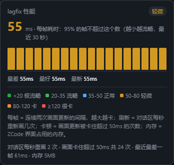
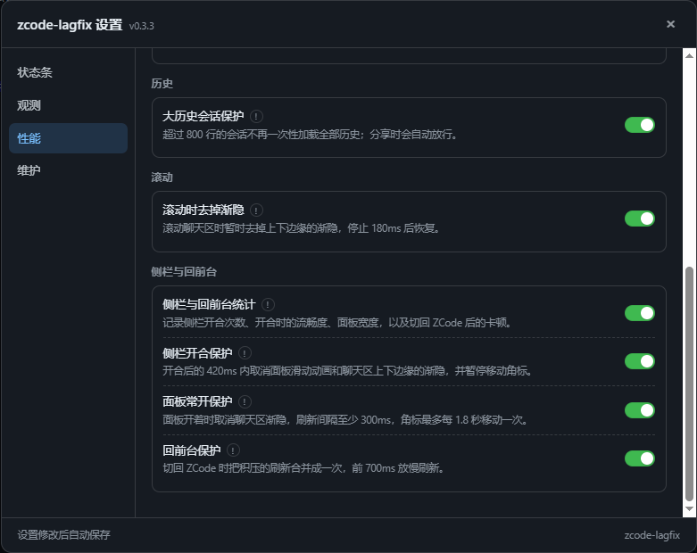

<p align="center">
  
</p>

<h1 align="center">zcode-lagfix</h1>

<p align="center">
  <strong>ZCode 超长会话的卡顿观测与缓解插件</strong><br>
  把“卡不卡”变成可读的数字，在不改会话数据的前提下减少卡顿。
</p>

<p align="center">
  <a href="https://github.com/ck-ys/zcode-lagfix/tree/plugin-releases"></a>
  <a href="LICENSE"></a>
  <a href="#兼容性"></a>
  <a href="https://www.python.org/"></a>
</p>

<p align="center">
  <sub>不读写 db.sqlite · 不读会话正文 · 不开 CDP · 不联网上报 · 一键还原</sub>
</p>

下面是在演示页面运行真实 observer 的截图：数据来自模拟卡顿，不含任何真实会话内容。

<p align="center">
  
</p>

ZCode 桌面版**超长会话卡顿**的观测与缓解插件。它做两件事：

1. 把"卡不卡"变成可读的数字——帧间隔、投影提交速率、主线程长任务；
2. 在不修改会话数据的前提下，合并高频渲染通知，并拦住进入大历史会话时的一次性全量补拉。

所有缓解项都可以**单独关闭**；全部关闭后，三处宿主包装（`subscribe` / `loadAllOlder` / `loadOlder` 观测）会还原为原始实现，观测仍按"观测"开关运行，角标常驻（布局受限时自动隐藏）。插件不读写 `db.sqlite`、不改消息与会话内容、不开 CDP 端口、不联网上报。网络请求只有一类：检查更新——手动点击时请求一次公开 GitHub Releases；自动检查默认关闭，开启后 24 小时内最多一次，结果只写本机 `localStorage`。

> 社区项目，非 ZCode 官方功能。通过修改 `app.asar` 加载，依赖客户端内部 DOM 与接口；ZCode 大版本改版可能需要适配。MIT License，按「现状」提供。

## 已解决的问题

长会话卡顿通常不是单一原因。zcode-lagfix 把它们拆成三条独立指标，避免"帧率低"和"提交太频繁"混为一谈：

| 指标 | 采集方式 | 回答的问题 |
| --- | --- | --- |
| 帧间隔 | `requestAnimationFrame` 相邻时间戳 | 界面看上去卡不卡 |
| 提交速率 | `[data-session-id]` 上 `data-projection-seq` 的变化 | 宿主投影提交有多频繁（负载，不是帧率） |
| 长任务 | `PerformanceObserver("longtask")` | 主线程被单次阻塞多久、多少次 |

插件版本演进：

- **v0.1**：观测与实时角标，建立采集基线。
- **v0.2**：投影订阅通知节流，解决流式期间高频重渲染。
- **v0.3.0**：状态条移到输入框上方且只在主页面显示；新增四项可逐项关闭的性能增强；日志预算与当前日志量展示；市场安装支持一键卸载。
- **v0.3.1**：新增滚动窗口、`loadOlder` 与输入延迟三项只读观测；滚动期临时隐藏消息层遮罩；角标改为常驻（删除隐藏开关）；设置面板重排为 状态条 / 观测 / 性能 / 维护；「检查更新」可用（手动请求一次 GitHub Releases）。
- **v0.3.2**：新增多会话归因（按 `sid` 分桶记录提交/帧、DOM、挂载 turn、滚动 P95，最多 5 个）与 `loadOlder` 最近 10 次明细（耗时/行数/触发来源）；只读、默认开，不改宿主行为；`/lagfix report` 新增对应两段。
- **v0.3.3**：新增侧栏开合 420ms 保护、面板常开期保护与回前台 700ms 保护，默认开、可单独关；新增 `pane`/`refocus` 只读归因（开合帧 P95、面板宽度、后台时长、回前台帧 P95/合并补发数）；`/lagfix report` 新增「侧栏开合」「回前台」两段；设置面板的「!」说明统一改成「会做什么 / 不会做什么 / 代价」的大白话。
- **v0.3.4**：新增卡顿来源定位（只读，记录 ≥100 毫秒长帧的脚本归属与强制布局时长，回答「卡的时候到底在忙什么」）；新增两项默认关闭的实验缓解——大会话翻页降频（窗口超 3000 行时上翻补页至少间隔 600ms，减少 1–2 秒长加载扎堆）与长回合渲染减负（屏幕外的消息块跳过绘制，内容不折叠不隐藏）；`/lagfix report` 新增「卡顿来源定位」「翻页降频」两段。后端每次补页的全量过滤是 ZCode 自身成本，插件只能减少触发次数，不包装成已解决。
- **v0.3.5**：长帧归因补上上下文——每条 ≥100 毫秒长帧记录距上次通知、补发、滚动、消息提交的时间，并归类为节流补发 / 通知到达 / 滚动 / 其它；样本新增面板开合与「面板期合并是否生效」，报告新增来源分布。另加一项默认关闭的实验「面板常开时进一步合并」（面板期刷新下限 400ms、角标 3s）；右侧预览是 Electron `<webview>`，其绘制成本插件改不了，相关证据只作为上游文档，不包装成已解决。
- **v0.3.6**：新增默认关闭的实验「补页批量」——自动加载更早历史时，把单次请求的页大小从宿主默认 60 行提到 200 行（仍在上限内），减少同一段历史需要的加载次数。只改请求页大小，不跳过、不删除、不改变顺序；带独立开关，报告显示生效/放行次数。是否进入默认路径取决于实机 A/B，不把「少发请求」直接当成「已不卡」。
- **v0.3.7**：角标右侧与维护页「检查更新」行新增「有新版本」小红点；新增可选的自动检查更新（默认关闭，开启后 24 小时内最多一次，只请求公开 GitHub Releases，不自动下载/安装、不上报本机数据）。检查结果缓存在本机，跨窗口与重启后仍能看到红点；缓存版本与当前版本不一致、最新版本与当前相同或已是最新时都不显示。
- **v0.3.8（当前）**：日志清理加固（只删，不覆盖）。只认白名单内的插件日志；`observe-` 日期必须真实，运行目录本身是符号链接/非目录时整轮跳过；最近 10 分钟写入的文件不删；删前重新 `lstat` 复核并按当前大小修正预算。安装器清理临时文件也收紧为只认运行时文件名，不再误碰用户或其它插件的 `*.tmp-<pid>`。

## 遇到问题

先跑一次 `/lagfix report`，它会打印「基线 / 问题窗口 / 恢复后」三段指标；这比只说“很卡”更容易定位。

反馈入口：

- **推荐**：打开 [问题模板](https://github.com/ck-ys/zcode-lagfix/issues/new?template=bug_report.yml)，按提示填写。模板会要求附上：
  - `/lagfix report` 的完整输出；
  - ZCode 版本、插件版本、操作系统；
  - 复现步骤，以及卡顿发生在滚动、输入、切会话、侧栏开合还是回前台；
  - 日志文件：`~/.zcode/zcode-lagfix/main.log` 和最近一个 `observe-YYYYMMDD.jsonl`（可直接拖进 issue）。
- 也可以直接开 [空白 issue](https://github.com/ck-ys/zcode-lagfix/issues/new)。

日志里只有指标、设置快照、窗口 id、会话 sid 与计数、补页元数据、长帧脚本文件名；不含提示词、回复、消息正文、工具参数或文件内容。提交前仍请自己过一眼，删掉不想公开的路径或用户名。

性能问题请尽量写清：

1. 会话大概多长（消息数 / 历史行数）；
2. 从哪滚到哪、是否连续上翻；
3. 哪些开关开着（尤其「补页批量」「翻页降频」「长回合渲染减负」）；
4. 有条件的话做一轮开/关 A/B，各贴一份 `/lagfix report`。

想直接改代码也欢迎 PR：先读 `AGENTS.md`，行为改动请带测试，性能改动请附前后对比数据。

## 安装

### 一键安装（推荐）

需要 **ZCode 桌面版**（Windows / macOS）与 **Python 3.8+**。不需要 Node，也不需要第三方 Python 包。

把下面整段发给 ZCode：

```text
请安装或更新并启用 ZCode 插件：https://github.com/ck-ys/zcode-lagfix#plugin-releases
完成后在新会话里执行 /lagfix install，确认补丁已注入；成功后提醒我完全退出并重新打开 ZCode（仅关闭窗口不算），不要自动重启。
若安装失败，请说明原因；若当前会话无法执行命令，请提示我手动执行，不要跳过或声称安装成功。
```

安装流程：

1. ZCode 从 `plugin-releases` 渠道拉取插件并启用。
2. `SessionStart` 钩子把运行时文件同步到 `~/.zcode/zcode-lagfix/`，并幂等注入 `app.asar`。
3. `/lagfix install` 可在当前会话立刻触发一次，适合修复被 ZCode 升级覆盖的注入。
4. 首次注入成功后**必须完全退出 ZCode（含托盘）再重开**；只关窗口或重开会话不算。

### 安装失败时

- **权限不足**（例如 ZCode 装在 `Program Files`）：让 ZCode 以管理员身份运行一次，或按 `/lagfix install` 输出的提示提权执行。钩子触发的失败写入 `~/.zcode/zcode-lagfix/hook-error.log`；手动执行 `install.py` 的失败写在终端和 `install.log`。
- **ZCode 正在运行**：`app.asar` 被占用时注入会挂起为 pending；完全退出后由值守进程自动收尾，重开即生效。
- **注入成功但状态条不出现**：先看 `/lagfix report` 的三段式诊断（未注入 / 注入了但观测器没起来 / 还没采到数据），再检查是否完全重启过。
- **以前卸载过，现在重新安装却没反应**：卸载会写 `~/.zcode/zcode-lagfix/.lagfix-optout`，钩子看到它会跳过注入。删除该标记后重试即可（见下文「恢复使用」）。

## 使用

### 状态条

主页面输入框上方显示：

```text
● 流畅  每帧 18ms  ⚙
```

- 判定词来自帧 P95 档位：极流畅 / 流畅 / 正常 / 轻微 / 卡 / 很卡；另有空闲 / 卡死 / 已暂停 / 已停。
- **颜色由面板里的黄/红阈值决定**：帧 P95、"卡死"停顿、最近 30 秒峰值都套同一组阈值；超过 30 秒的历史峰值不参与，不会因为一次 788ms 永久报红。
- 状态条用 fixed 定位，每秒按输入框 `getBoundingClientRect()` 同步坐标，不插进 React 树，避免被宿主重渲染清掉。
- 位置在输入框顶边上方，**不压输入区、模型选择与发送按钮**；与排队面板、额度横幅、待恢复提示、回到最新按钮相交时整体上移；上方没有余量时暂时隐藏。
- **只在主页面显示**：设置页、弹窗、被浮层盖住的输入框一律排除；分屏或草稿页同时存在多个 composer 时，取最靠下的可用者。

### 统计浮层

**悬停或点击状态条**打开统计浮层：

- 大号帧 P95、六档颜色图例；
- 最近 18 个采集周期的柱状图；
- 峰值 / 最低 / 最新帧间隔；
- 投影提交速率与长任务次数。

点击是固定展开，点页面别处或再点一次收起；悬停 120ms 后自动展开，移开 260ms 收起。

### 设置

点状态条末尾的齿轮，打开居中分类设置：

| 分类 | 内容 |
| --- | --- |
| 状态条 | 显示文字、信息量（简洁/详细）、警告/严重阈值 |
| 观测 | 观测开关、采集间隔 1 / 3 / 5 / 10 / 30 秒、滚动诊断、输入延迟、多会话分别统计 |
| 性能 | 合并刷新与最短刷新间隔、卡顿时自动放慢、切换会话时放慢、后台时减少刷新、大历史会话保护、滚动时去掉渐隐、侧栏与回前台保护（可逐项关闭） |
| 维护 | 日志路径与上限、当前日志量、重启 ZCode、检查更新、反馈问题、恢复默认 |

性能页每一项标题后都有圆圈「!」，点开用「会做什么 / 不会做什么 / 代价」三段说明，不写内部字段名。

设置面板的「性能」页：

<p align="center">
  
</p>

**角标常驻显示**（v0.3.1 起删除了隐藏开关）：在设置页/弹窗内、被浮层遮挡、没有可用输入框时仍会自动隐藏，这是布局避让，不是用户开关。设置入口始终可用：

- 点角标末尾的齿轮
- `Ctrl+Alt+L`（macOS：`Cmd+Alt+L`）
- 控制台执行 `__lagfixSettings()`

「检查更新」默认只在你点击时请求一次 GitHub Releases（`api.github.com`，https，无 token）；打开「自动检查更新」后改为 24 小时内最多一次。两者都不会自动下载或安装；升级仍走下面的插件市场流程。

设置保存在 `localStorage["lagfix.settings.v1"]`，更新检查结果单独放在 `localStorage["lagfix.update.v1"]`；两者都只在本机，多窗口通过 `storage` 事件同步。主进程侧镜像设置到 `~/.zcode/zcode-lagfix/settings.json`，便于排查。

## 性能增强与取舍

### 订阅通知节流（v0.2）

宿主大约每 30ms 提交一次投影并通知所有订阅者，React 在 `useSyncExternalStore` 回调里整树重渲染，把主线程切碎。节流把**通知**合并为最多每窗口一次：

- **trailing 必达**，不是 debounce——持续流式时也会持续刷新；
- 只包装 `subscribe(listener)` 这种一参调用；带 selector 的 `subscribeWithSelector` 原样放行，否则会冻结 UI；
- 状态照常写入 store，只延后渲染通知，**不改任何数据**；
- 节流窗口按 **store 实例**计时，而不是按订阅——React 19 每次 commit 都会用新的内联箭头重新订阅，按订阅计时会让窗口在每次重订阅时清零；
- 找不到 store 时降级显示"待生效"，并每 3 秒重试（最多 20 次）；
- 关开关立即恢复即时通知；观测器自禁用时同步还原。

稳态默认窗口 120ms（面板可调 30~1000ms）。开启下面的增强后，窗口会按条件延长：

| 场景 | 最大通知间隔 |
| --- | --- |
| 稳态 | 120ms（面板可调） |
| 自适应窗口：帧 P95 ≥ 80ms / ≥ 150ms | 至少 200ms / 300ms（面板值更大时保持面板值） |
| 切会话后 10 秒内 | 不低于 250ms |
| 窗口在后台 | 最多 1 秒 1 次，回前台立即补一次 |

因此"渲染最多滞后 120ms"只适用于稳态。开启增强后实际窗口取 `max(面板窗口, 200/300ms)`：面板保持默认 120ms 时，极端情况约 300ms；若用户把窗口调到 1000ms，则保持 1000ms。后台最多 1 秒。这是用可感知的延迟换取主线程先完成首屏挂载与布局。

### v0.3 四项增强（全部可单独关闭）

进入或切换大历史会话时，宿主会为问题导航目录、分享目录做**一次性全量补拉**（`loadAllOlder` 分页读完再一次性换 snapshot），DOM 从几千行突然涨到上万行。v0.3 在"不动宿主数据"的前提下提供四个开关：

| 开关 | 默认 | 触发条件 | 行为 | 关掉后 |
| --- | --- | --- | --- | --- |
| 自适应窗口 | 开 | 最近帧 P95 ≥ 80ms / ≥ 150ms | 通知窗口至少 200ms / 300ms（以面板值为下限），帧恢复后回落 | 只按固定窗口 |
| 切会话冷静期 | 开 | 切/新建会话后 10 秒内 | 窗口不低于 250ms，让主线程先完成首屏挂载 | 切会话立即按固定窗口 |
| 后台降频 | 开 | `document.hidden` | 通知最多 1 秒 1 次；回前台立即补一次 | 后台仍按前台频率通知 |
| 大历史会话保护 | 开 | 总行数 ≥ 800 且只加载了一部分 | 拦下 `loadAllOlder` 全量补拉，返回 `not-enough-queries`（宿主视为终态，不会重试风暴）；分享入口点击后 15 秒内、分享弹层挂载期间自动放行 | 恢复宿主的一次性全量补拉 |

边界与取舍：

- 前三个开关只影响"什么时候通知 React 渲染"；大历史会话保护影响"要不要执行一次性全量补拉"。两者都**不改 store 数据、不改消息、不碰 `db.sqlite`**。
- 大历史会话保护的代价：大历史会话里问题导航的目录只覆盖已加载部分；正常上翻分页（`loadOlder`）、当前可见消息不受影响。
- 自适应窗口有 1 秒缓存，避免每次通知都重算帧统计。
- 全部关闭等价于 v0.2.3 行为；`__lagfixOff()` 会同时关掉节流与大历史会话保护、还原被包装的方法，并在本轮真的拦过补拉时自动补拉一次。

### v0.3.1 滚动观测与遮罩抑制

滚动卡顿和"进入会话时的一次性全量补拉"不是同一回事，v0.3.1 先把滚动这条链路量清楚，再提供一个可 A/B 的绘制层缓解：

| 项 | 默认 | 行为 | 关掉后 |
| --- | --- | --- | --- |
| 滚动诊断 | 开 | 只统计滚动后 200ms 内的帧（P95/max）、时间线 `scroll` 事件数、`loadOlder` 次数/耗时/失败、挂载 turn 数、DOM 峰值、浏览器支持时的 `long-animation-frame` | `collect` 的 `scroll` 为 `null`，不再做额外 DOM 扫描 |
| 输入延迟 | 开 | 只统计输入框内 `keydown` 到下一帧的间隔（P95/max/样本数），复用现有 rAF 循环 | `collect` 的 `input` 为 `null` |
| 滚动期隐藏遮罩 | 开 | 时间线滚动时给 `documentElement` 加 `data-lagfix-scroll="1"`，停滚 180ms 后移除；CSS 只覆盖消息层的 `mask-image` | 不添加属性，滚动时遮罩保持原样 |

边界与取舍：

- `loadOlder` **只观测**：不拦截、不延迟、不改返回值；`scroll.p95` 只代表"滚动后 200ms 内的帧"，不等于整段会话帧率。
- `input.p95` 只能说明"按键到下一帧"变慢，不能区分是浏览器输入延迟还是主线程排队；它**不修复**按键卡顿。
- 遮罩抑制只影响绘制，不改布局与 DOM。它的前提是宿主当前用**内联** `mask-image`（无 `!important`）；若宿主改成 `!important` 内联写法，本项会静默失效，靠 `scroll.p95` 与人工 A/B 发现。
- `scroll.mismatch`（`anyEvents>0 && events===0`）说明"有人在滚，但没命中已知时间线选择器"，先跑 `/lagfix report` 判断宿主是否改版。

### v0.3.2 多会话归因与补页明细

v0.3.1 能证明"有尖峰"，但分不清尖峰来自当前会话、隐藏会话还是一次补页。v0.3.2 只补证据，不改任何渲染/补页行为：

| 项 | 默认 | 行为 | 关掉后 |
| --- | --- | --- | --- |
| 多会话归因 | 开 | 按 `data-session-id` 分桶（最多 5 个），记录每个会话的投影提交次数/速率、DOM 节点数、挂载 turn 数、滚动帧 P95、可见性与最近活跃时间；隐藏 pane 也记录并标 `visible=false`；占位 sid（`draft`/空）切成真实会话后删除占位桶 | `collect` 的 `sessions` 为 `null`，不再遍历会话 pane |
| `loadOlder` 明细 | 随滚动诊断 | 最近 10 次调用的耗时、promise 是否正常结算、调用前后 `rows.window` 长度、触发来源（`scroll` / `initial` / `unknown`）；只读长度，不读分页内容。只包装主 store 实例，暂停期间不累计 | `collect` 的 `loadOlderDetail` 为 `null` |

边界与取舍：

- 最多 5 个桶；发现阶段满 5 个后额外 pane 只观察不建桶，等它有真实提交/滚动才淘汰最久未活跃的旧桶，历史数字随之丢失。切会话本身不算活跃，同值 SID/seq 重写也不计数。
- `visible` 只代表 CSS/几何可见，不代表"最前台"；分屏时两个 pane 可以同时为 `true`。
- `frames`/`commitRate` 依赖宿主继续更新 `data-projection-seq`，且只统计值真的变化；隐藏 pane 若被宿主停止渲染，会如实显示 0，这不等于"隐藏 pane 不耗资源"。
- `mountedTurns`/`dom` 是 pane 子树口径，固定每 60s 采样一次（新桶立即采）；`scroll.mountedTurns`/`domPeak` 仍是整窗口径，两者不能直接相加对比。
- `loadOlderDetail` 只覆盖当前主 store 实例（主 pane），不修改共享原型；`trigger` 是时间启发式（滚动后 2s 内 / 挂载后 5s 内的首次调用），不能证明宿主内部调用原因。
- 宿主 `loadOlder` 内部失败会打日志后正常 resolve，因此 `ok=true` 只表示"promise 正常结算"；报告会把行数未变标成"无变化"。
- `loadOlderDetail` 只在变化时携带完整数组，未变化样本发 `[]`；多会话归因每个样本约增加 0.4–0.6KB。默认 50MB 日志预算下如需要更长历史，可在面板调大 `logMaxMB`。
- 本版不改变任何渲染/补页行为，不应期待帧率变化；它的价值是让 v0.3.3 的缓解项有数据依据。

### v0.3.7 更新提醒（小红点 + 可选自动检查）

手动「检查更新」只能用一次点一次，很容易忘记。v0.3.7 把检查结果缓存在本机，并在有新版本时给角标和维护页加一个小红点：

| 项 | 默认 | 行为 | 关掉后 |
| --- | --- | --- | --- |
| 有新版本小红点 | 随检查结果 | 缓存里的 `newer=true`、缓存版本等于当前版本、且最新版本与当前不同时，角标右侧与维护页「检查更新」行显示红点 | 缓存被清空或已是最新时红点消失 |
| 自动检查更新 | 关 | 开启后 ZCode 启动/窗口打开时最多检查一次；`checkedAt` 存在本机，24 小时内不重复。只请求公开 GitHub Releases，不自动下载/安装，不上报本机数据 | 回到只能手动点击「检查更新」；已有缓存与红点仍会展示 |

边界与取舍：

- 自动检查是**显式选择**：默认关闭；关闭时只有手动点击「检查更新」才会联网，打开后也只在 ZCode 打开期间按 24 小时上限检查。检查失败只影响那一行提示，不影响观测与其他开关。
- 结果写在 `localStorage["lagfix.update.v1"]`，跨窗口与重启保留；它只含版本号、是否有新版本、release 链接与时间戳，不含会话数据。
- 红点不是「已下载」或「已安装」：插件不自动下载、不自动安装，也不会替用户重启 ZCode；升级仍走安装口令与手动重开。
- 缓存版本与当前版本不一致时红点会隐藏（例如刚升级到新版本，旧缓存还没刷新）；下一次检查完成后重新判断。
- `__lagfixOff()` 会关闭自动检查、清掉更新缓存与两处红点；手动检查按钮保持可用。

### v0.3.6 补页批量（默认关闭的实验）

v0.3.5 的实机数据显示，超长会话的卡顿大头不在「多久补一次」，而在「每次补页本身」：单次补页会触发后端全量过滤当前会话、整窗拷贝与宿主重渲染，最长可达 1.5 秒，而翻页降频只覆盖到极少数触发。ZCode 的 `loadOlder` 本身接受页大小参数，协议上限 200 行，插件默认不动它；v0.3.6 提供一项默认关闭的实验：

| 项 | 默认 | 行为 | 关掉后 |
| --- | --- | --- | --- |
| 补页批量 · 实验 | 关 | 仅当调用方**没有传参数**时，把单次补页的页大小从宿主默认 60 行提到 200 行（协议上限内）；调用方显式传参一律原样放行 | 恢复宿主默认 60 行，其余行为不变 |

边界与取舍：

- 只改**请求页大小**：不跳过、不合并、不缓存、不删除任何消息，也不改变顺序；`this`、Promise、异常、加载中状态全部由原方法决定。
- 单次补页仍然要付宿主后端全量过滤的成本，本项只减少同一段历史需要的**次数**，不降低单次耗时；不能写成「已解决补页卡顿」。
- 一次加载的内容更多，个别情况下滚动到更早历史时位置可能轻微调整；已做过宿主契约核对（`loadOlder(limit)` 存在、上限 200），但不自动探测宿主改版：参数若被忽略或截断，行为会自然退回默认，需要人工复核报告里的补页次数。
- 暂停观测只停采集，不关闭替换，计数继续累计；若暂停期间宿主重建会话数据，替换要等恢复观测或下一次设置变更/切会话才装到新实例上。
- 需要实机 A/B：补页次数下降 ≥50%，且补页总阻塞或滚动 P95/长任务下降 ≥20%，才考虑进入默认路径；未过线保持默认关闭。
- 与「大会话翻页降频」独立：降频先决定是否调用，本项只决定调用时的页大小；两项都关时 `loadOlder` 包装按原条件卸载。

### v0.3.5 长帧上下文与面板期进一步合并

v0.3.4 能回答「卡的时候哪个脚本最贵」，但分不清是插件合并刷新、滚动、宿主提交还是预览绘制。v0.3.5 先补上下文，再用默认关闭的 O5 做一次低风险尝试：

| 项 | 默认 | 行为 | 关掉后 |
| --- | --- | --- | --- |
| 长帧上下文归因 | 开 | 只读：每条 ≥100ms 长帧记录距上次通知/补发/滚动/消息提交的毫秒数，并归类为 `flush` / `notify` / `scroll` / `other`；样本带本周期来源分布与 `paneOpen` / `panelQuiet` | 样本 `laf.ctx=null`，明细不带 `src` 与四个时间差 |
| 面板常开时进一步合并 · 实验 | 关 | 面板打开期间通知节流下限 300→400ms、角标定位 1.8s→3s；面板关闭后新通知回到基础间隔（默认 120ms），在途一次最多按原窗口送达 | 面板仍开且「面板常开保护」开时回到 300ms / 1.8s；面板关闭后回到基础间隔 |

边界与取舍：

- `notify` / `flush` 上下文依赖「合并刷新」开启；关掉合并刷新时没有插件侧通知时间戳，来源会落到 `scroll` 或 `other`。
- 归因是**窗口级**的，`sinceCommit` 只跟踪活动 pane 的投影序号；多 pane 同时提交时不能精确到某个 pane。
- O5 需要实际 A/B：长会话 + 面板打开 + 高频滑动，比较开/关的长帧数或 `frameP95`，下降 ≥20% 才值得保持开启；未过线就保持默认关闭。
- 右侧预览是 Electron `<webview>` guest，面板内滑动的主线程/合成成本落在宿主渲染进程；插件无法接管，U1 只把证据交给上游。
- 仍只记录指标与时间差，不读消息正文、不写 store、不联网上报。

### v0.3.4 卡顿来源定位与两项实验缓解

实机数据（超长会话上翻）显示：单次补页最长 2262ms、DOM 峰值 8691、3 秒内长任务 32 次。v0.3.4 先把「卡的时候到底在忙什么」量出来，再提供两项默认关闭的实验缓解：

| 项 | 默认 | 行为 | 关掉后 |
| --- | --- | --- | --- |
| 卡顿来源定位 | 开 | 只读记录 ≥100ms 长帧：总时长、各脚本强制布局时长之和、耗时前 5 的脚本（只记文件名，不记路径/内容），最多保留最近 10 次 | 样本 `laf` 为 `null`，不装 LoAF 观察器（滚动诊断也关时） |
| 大会话翻页降频 · 实验 | 关 | 窗口超 3000 行时，上翻触发的补页至少间隔 600ms；被跳过的触发不碰 ZCode 状态，继续滚动会自动补上 | 所有补页触发原样放行 |
| 长回合渲染减负 · 实验 | 关 | 给 `documentElement` 加 `data-lagfix-cv="1"`：turn 内部行级块（不含正在生成的回合）屏外跳过绘制，滚回附近恢复；已渲染过的块高度占位不变，不扰动滚动定位 | 移除属性，绘制行为与原版完全一致 |

边界与取舍：

- 后端每次补页要先过滤整个会话投影再取一页（宿主默认 60 行；开启 v0.3.6 补页批量实验后为 200 行），这是 ZCode 自身成本，插件降不了单次耗时，只能减少触发次数；翻页降频不解决它，只是少撞几次。
- 翻页降频：停在触发区不再滚动时，被跳过的补页要再滚一下才会补上；快速上翻时更早的历史可能晚一点出现。
- 渲染减负：个别从未绘制过的消息块第一次滚到时位置可能轻微校正；不折叠、不隐藏任何内容，搜索与选中不受影响。
- 两项实验按 A/B 数据定去留：滚动 P95 或长任务下降 ≥20% 才值得保持开启，否则建议关闭，等 ZCode 上游优化。
- 卡顿来源定位只记脚本文件名与时间，不含会话内容、路径或参数。

### v0.3.3 侧栏开合、面板常开期与回前台

右侧面板不只是"打开那一拍"贵：面板常开时仍有遮罩与重绘成本，从别的应用切回 ZCode 还会同步补发后台通知。v0.3.3 把它拆成三段，每段独立开关：

| 项 | 默认 | 行为 | 关掉后 |
| --- | --- | --- | --- |
| 侧栏与回前台统计 | 开 | 只读记录 `pane.detected/open/panelPx/switches/switchP95/switchMax/guardHits` 与 `refocus.hiddenMs/sinceVisibleMs/p95/max/flushes/guardHits`；回前台同时听 `visibilitychange` 与 `window.focus/blur` | `collect` 的 `pane`/`refocus` 为 `null`；若保护项仍开，只保留最小开合检测 |
| 侧栏开合保护 | 开 | 开合后 420ms 内给 `documentElement` 加 `data-lagfix-pane-switch="1"`：停掉 `[data-panel]` 的过渡、临时关消息层 mask、暂停角标定位 | 不加属性，宿主原过渡与遮罩完全不变 |
| 面板常开保护 | 开 | 面板打开期间加 `data-lagfix-pane-open="1"`：关消息层 mask、通知窗口至少 300ms、角标定位最多 1 次/1.8s | 不加属性，节流与角标回到原规则 |
| 回前台保护 | 开 | `hidden→visible` 或 `blur→focus` 后，把后台挂起的通知合并到一个 120ms 定时器；700ms 内通知窗口至少 400ms；前 300ms 不定位角标 | 恢复同步补发，不抬下限、不跳过角标 |

边界与取舍：

- 开合保护只覆盖 420ms（200ms flex 过渡 + 220ms 重内容 settle）；代价是开合从滑动变成瞬开/瞬收，不想要就关 P1。
- 面板常开期停 mask、把通知窗口抬到 300ms，聊天文字最多晚 300ms 刷新；Agent 收流、工具执行、消息落盘不受影响。
- 回前台最多晚 120ms 补状态；只延迟插件自己挂起的通知，宿主自己的首帧重绘不被拦截。
- `pane.detected=false` 表示宿主改版或当前布局没有桌面侧栏（如移动端 overlay），插件不猜选择器、也不加保护属性；先跑 `/lagfix report` 判断。
- 三段都只改通知时机、绘制层属性与角标定位；不改消息、会话数据、补页返回值，不写 store。若卡顿来自预览 HTML 自身绘制或宿主其它长任务，这三段仍可能不够。

## 日志、体积与隐私

运行时目录：`~/.zcode/zcode-lagfix/`

| 文件 | 内容 |
| --- | --- |
| `observe-YYYYMMDD.jsonl` | 每个采集周期的指标（帧、提交、长任务、堆内存、DOM 数量、滚动/输入诊断、多会话归因、loadOlder 明细、侧栏/回前台归因、设置快照） |
| `main.log` | 主进程加载器（注入、采集泵、自禁用原因） |
| `inject.log` | 每个窗口的注入结果 |
| `monitor.log` | 值守进程（何时等到、为何收不了尾） |
| `install.log` | 安装器动作与退出码 |
| `hook-error.log` | `SessionStart` 钩子异常 |
| `elevated-finalize.log` | 管理员权限收尾（仅使用提权工具时产生） |
| `settings.json` | 渲染端设置的只读镜像 |

日志清理只操作 `~/.zcode/zcode-lagfix/` 的直接子项，且文件名必须命中本插件白名单；`observe-` 的 8 位日期必须是真实日期。每次删除前用 `lstat` 复核「普通文件、非符号链接、路径仍在运行目录」，并跳过运行目录本身是符号链接、以及最近 10 分钟内写入的文件。符号链接、目录、用户文件、`settings.json`、今天正在写的 `observe-*.jsonl` 与未轮转的活动日志一律不删；任何异常都跳过（宁可超预算，也不误删）。

体积控制：

- 上述日志共享一个总预算，默认 **50MB**，面板「维护」页可改 20 / 50 / 100 / 200MB；
- 单个 `observe-*.jsonl` 达到 5MB 自动轮转为 `.1`；
- 超出总预算时**从最旧的文件开始删**，当天的活动观测文件不删；
- 观测日志另有 14 天保留上限（启动时检查一次，之后每小时补查）；
- 维护页实时显示**当前日志量与文件数**（不足 1MB 按 KB 显示），随每个采集周期刷新。

隐私边界：

- 只记录指标、窗口 id、设置快照与长帧的脚本文件名/调用点（截断，不含路径），**不记录**提示词、模型回复、文件内容、工具参数或数据库；
- 所有数据只写本机目录，不上传；除检查更新外不联网——手动点击时查询一次公开 GitHub Releases，开启自动检查后 24 小时内最多一次（无 token、不自动下载/安装）；
- 不打开 CDP 端口，不读取 `db.sqlite`。

## 卸载

**先完全退出 ZCode（含托盘 / 任务管理器确认无 `ZCode.exe` 与 `zcode-runtime-host.exe`）**，再执行对应命令。`uninstall` 会先写豁免标记占位（堵住并发的钩子/收尾重装），再剥注入行；ZCode 仍在运行时 `remove` 返回 `failed` 并撤回标记，**最终状态仍是未卸载**，避免"号称卸了其实还在"。

### 从 GitHub 市场安装

```bash
python "$HOME/.zcode/zcode-lagfix/patch_install.py" uninstall
```

然后到 **设置 → 插件 → 已安装 → zcode-lagfix → 卸载**，再重开 ZCode。顺序不要反。即使不小心先卸载了插件，`~/.zcode/zcode-lagfix/patch_install.py` 仍然保留，完全退出 ZCode 后跑同一条 `uninstall` 即可清干净。

### 从源码安装

在仓库根目录执行：

```bash
python install.py remove
```

### 恢复使用

任何一次成功卸载都会留下 `~/.zcode/zcode-lagfix/.lagfix-optout`，它会让 SessionStart 钩子静默跳过注入。所以恢复顺序固定为：**先删标记，再安装**。

```bash
python -c "import pathlib;pathlib.Path.home().joinpath('.zcode','zcode-lagfix','.lagfix-optout').unlink(missing_ok=True)"
```

- 插件仍在启用：执行 `/lagfix install`。
- 插件已从市场卸载：先在 **设置 → 插件** 里重新安装并启用 zcode-lagfix，再执行 `/lagfix install`。运行时目录里的 `patch_install.py install` 只会重新注入 asar，不会恢复插件注册、命令和钩子。

`uninstall` / `remove` 只剥 lagfix 自己的注入行，绝不影响已装的其它注入插件（如 zusage 状态条）。

## 零安装探针（先看数，再决定装不装）

仓库自带一个外部响应探针，不改 `app.asar`、不用退出 ZCode：

```bash
python tools/lagfix-probe.py --overlay
```

> 探针仅支持 **Windows**（使用 Win32 消息队列）；插件本体支持 Windows / macOS。

右下角出现置顶小窗，每秒显示 ZCode UI 线程的消息泵延迟。原理是向 ZCode 主窗口发送 `WM_NULL` 空消息并计时：UI 线程被渲染占满时消息只能排队，回得就慢。这与系统判定"窗口无响应"走同一条路径；**不注入、不读窗口内容、不改任何文件**。

判读：

- P50 < 20ms：流畅
- P95 20~80ms：轻微掉帧
- P95 > 80ms：明显卡顿
- 单次 > 500ms：卡死级别

方法本身有自动化验证（`tests/probe_latency.py`：空闲约 0.03ms vs 人为占死 UI 线程 1024ms）。

## 从源码安装（开发）

在仓库根目录执行：

```bash
python install.py
```

安装器会：

1. 复制插件到 `~/.zcode/cli/plugins/cache/lagfix-marketplace/zcode-lagfix/<version>/`（只保留当前版本）；
2. 登记市场与插件，写 `enabledPlugins`；
3. 同步运行时文件到 `~/.zcode/zcode-lagfix/`；
4. 注入 `app.asar`。

ZCode 运行中时补丁会挂起（pending）。收尾不靠"数进程数 == 0"，而是每 2 秒直接尝试 `os.replace`，由操作系统仲裁：Windows 不允许 rename 覆盖已被打开或映射的文件，所以"能替换"就等于"确实没人握着它"。完全退出 ZCode 后 2 秒内自动完成，再打开即生效。

查看状态：

```bash
python install.py status
python "$HOME/.zcode/zcode-lagfix/lagfix_report.py"
```

报告按三段式诊断：未注入 / 注入了但观测器没起来 / 还没采到数据。

## 兼容性与共存

- **与 zusage 等注入插件共存**：注入行标记 `[lagfix] load failed`、loader 名 `lagfix-main.cjs`，与 zusage 的 `inject-main.cjs` / `[zusage] load failed` 互不匹配；锁、TMP、sidecar 文件名全部错开。
- **多插件收尾错峰**：检测到其它待收尾包时主动让对方先落地（累计上限 120 秒），等不到就放弃本轮，避免让别人的补丁永久失效。
- **宿主改版**：状态条依赖 `.chat-composer-input-surface`、`[data-v4-back-to-bottom-anchor="composer-dock"]` 与投影 store 的内部形状；侧栏保护依赖 `[data-workspace-side-frame="true"]` 的 `aria-hidden` 和外层 `[data-panel]`。ZCode 大版本改版后若状态条消失或 `pane.detected=false`，先执行 `/lagfix report` 判断是注入丢了还是选择器不匹配。
- **平台**：Windows 与 macOS 桌面版；Linux 桌面版未验证。

## 安全设计

- asar 手术逐文件断言读取长度 == 节点 size；stage 写入后 flush + fsync；替换前校验源 asar 指纹（size + mtime_ns + st_dev + st_ino）。
- 替换失败挂 pending，由值守进程在 ZCode 全退后收尾；收尾遇他人替换时基于当前文件重打。
- 注册表读失败一律中止，绝不回退空结构覆盖用户插件列表；写回采用 tmp + 原子替换，并保留当日备份。
- 改后入口用 `ZCode.exe --check`（`ELECTRON_RUN_AS_NODE`）做语法自检，30 秒超时。
- 运行时宿主包装只有三处：`subscribe`（只合并通知）、`loadAllOlder`（只在大会话且未全载时拦截）、`loadOlder`（默认只观测量耗时，不改参数与返回值；开启「大会话翻页降频」实验后会在大窗口内跳过 600ms 内的重复触发并返回已结算 promise；开启 v0.3.6「补页批量」实验后，只有无参调用会被替换为 `loadOlder(200)`，显式参数原样放行；均不碰 ZCode 状态机）。v0.3.3 起另有 `data-lagfix-pane-switch` / `data-lagfix-pane-open` 两个临时 `documentElement` 属性，v0.3.4 实验项再加常驻的 `data-lagfix-cv`（仅开关开启时存在）；v0.3.5 的长帧上下文归因只读时间戳、不新增包装，O5 只改通知/角标时机、不新增 DOM 属性；三条路径（关开关、自禁用、`__lagfixOff()`）都会立即移除。
- 更新检查只允许 `https://api.github.com/repos/ck-ys/zcode-lagfix/releases`（重定向逐跳校验、最多 2 跳、总时限 10 秒、响应体上限 2MB），不带 token；自动检查默认关，主进程按 24 小时去重，结果只写本机 `localStorage`，不回传任何本机数据。

## 测试

在仓库根目录执行：

```bash
node --check plugins/zcode-lagfix/lagfix-main.cjs
node --check plugins/zcode-lagfix/lagfix-observe.js
python -m py_compile install.py plugins/zcode-lagfix/*.py plugins/zcode-lagfix/hooks/*.py

python tests/line_regex.py      # 注入行正则与 zusage 互不误伤（11 项）
python tests/peer_gate.py       # 多插件收尾礼让与上限（5 项）
python tests/smoke_asar.py      # 合成 asar 夹具，byte 级验证重打包、busy 与卸载竞态（46 项，不碰真实安装目录）
python tests/install_remove.py  # install.py 卸载异常边界：Ctrl+C / 占用 / 插件态写入失败 / 临时文件清理只认运行时文件名（11 项）
python tests/report_session_diag.py # 报告：会话桶/补页明细/侧栏与回前台/卡顿归因/翻页降频/补页批量/长帧来源分类/暂停回退/关闭边界/坏行（80 项）
python tests/probe_latency.py   # 外部探针方法有效性：空闲 vs UI 线程占死
node tests/observe_smoke.mjs    # 渲染端：可见性/角标/节流/滚动诊断/输入延迟/多会话/loadOlder/侧栏与回前台/卡顿归因/长帧上下文/补页批量/更新红点/反馈入口/翻页降频/渲染减负/面板期合并/日志/一键还原（479 项）
node tests/update_check.mjs     # 主进程检查更新：白名单/重定向/过滤/版本比较/体积上限/注入/自动检查去重（25 项，不联网）
node tests/log_budget.mjs      # 主进程日志预算：超限删最旧/保留活动文件/14 天清理/符号链接与目录跳过/权限失败/非法日期/最小年龄/目录安全（33 项，假 fs 不写盘）
```

自动化测试不等同于所有 Windows / macOS 实机验收；首次安装后请按上文完全重启，确认状态条出现且 `/lagfix report` 有数据。

## 路线图

- **v0.3.6 后续**：先做实机 A/B（同一会话、同一段历史、同一滚动路径，O8 关→开→关至少 3 轮），比较补页次数、补页总阻塞、滚动 P95、长任务、DOM 峰值、顶部空白与锚点漂移；未过线保持默认关闭。若「单次补页仍贵」被证实是主因，下一步应转向推动上游优化后端全量过滤，而不是继续在插件侧加码。
- **v0.3.5 后续**：按 P0 的来源分布决定方向——`flush` 高则继续评估面板期合并（O5 已默认关闭，过 20% 门槛才考虑进默认路径）；`other` 且距消息提交很近则转宿主渲染/上游证据；`scroll` 高再评估补页降频（O3b）。
- **v0.3.4 两项实验**：翻页降频与长回合渲染减负仍按实机 A/B 数据决定去留——滚动 P95 或长任务下降 ≥20% 才保留在默认路径推荐里，否则永久保持默认关闭并如实标注。
- **v0.4 候选**：多会话策略（O7，需先证明隐藏 pane 的提交/DOM 是主因）、非活动 pane 节流（O6）、turn 内再虚拟化；都需要宿主配合或更大的渲染端改造。
- **候选**：打开子智能体（Subagent）面板或多级任务时的卡顿：先量清是 DOM 规模、订阅通知还是面板挂载，再决定是否做成默认关闭的独立开关。
- **长期**：宿主改版后的选择器适配；自动下载/安装（当前只做手动检查或可选的自动检查，不自动下载、不自动安装）。

## License

[MIT](LICENSE) © 2026 ck-ys
